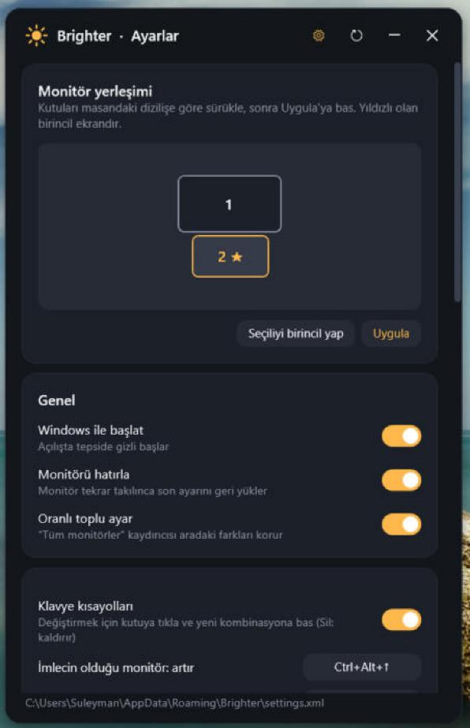

<p align="center"></p>

# Brighter

Control the brightness of every monitor on Windows from one small window: HDMI, DisplayPort, DVI, VGA, USB-C or a laptop screen, each with its own slider.

Bağlı her monitörün parlaklığını tek pencereden, ayrı ayrı ayarlayan küçük bir Windows aracı.

<p align="center">
  
  
</p>

## Download

Get it from the [latest release](https://github.com/PyePye-Digital/Brighter/releases/latest):

- **Brighter-Setup.exe**: normal installer, with a Start menu shortcut and a clean uninstall.
- **Brighter.exe**: portable, just run it.

Windows may show a SmartScreen warning the first time because the app is not code-signed. Click *More info → Run anyway*.

## What it does

- Brightness, contrast, colour temperature and volume for each monitor
- One slider for all monitors at once
- Switch a monitor's input (HDMI / DisplayPort…), turn a monitor off and on
- Arrange your monitors by dragging them
- Profiles, keyboard shortcuts, and day / night switching
- Dims when you are away, but not the monitor playing a video
- Lives in the tray, starts with Windows
- Turkish and English

## Requirements

- Windows 10 or 11
- For external monitors: **DDC/CI** turned on in the monitor's own menu (on by default on most monitors)

## A monitor does not respond?

- Turn on DDC/CI in the monitor's menu, then press refresh in Brighter.
- Some adapters, docks, KVM switches and old VGA cables block it; try a direct cable.
- TVs usually do not support it. Brighter then dims that screen in software instead.

If something goes wrong, Settings → *Open log* shows what happened. Please attach it when you open an issue.

## Command line

```bat
Brighter.exe --set 2 40        :: monitor 2 to 40 %
Brighter.exe --set all 70      :: all monitors to 70 %
Brighter.exe --profile Night
```

Also `--contrast`, `--volume` and `--temp` (Kelvin, 3400–6500).

## Build from source

Run `build.bat`; no SDK needed. The result is `bin\Brighter.exe`. `build-installer.bat` also makes the installer (needs [Inno Setup 6](https://jrsoftware.org/isinfo.php)).

GitHub Actions builds both on every push, and a tag like `v1.2.0` publishes a release.

## License

MIT — see [LICENSE](LICENSE).
