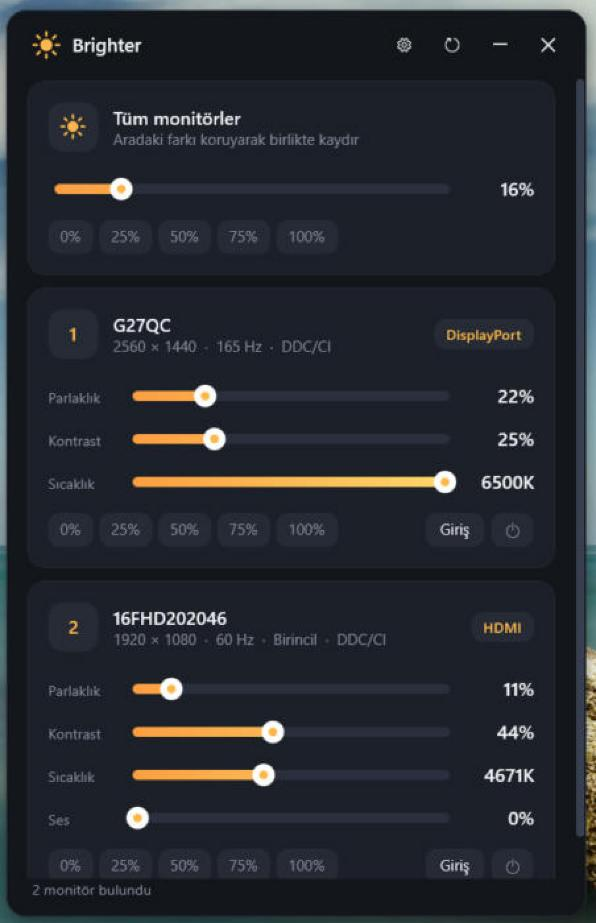

<p align="center"></p>

# Brighter

Per-monitor brightness, contrast, colour temperature and arrangement for Windows, in one small exe. Every display that is plugged in gets its own card — HDMI, DisplayPort, DVI, VGA, USB-C or the built-in laptop panel.

Bağlı her monitörün parlaklığını, kontrastını, renk sıcaklığını ve masaüstündeki yerini tek pencereden ayarlayan küçük bir Windows aracı.

<p align="center">
  
  
</p>

## Download

From the [latest release](https://github.com/PyePye-Digital/Brighter/releases/latest):

- **`Brighter-Setup-x.y.z.exe`** (recommended): installs for your user only, no administrator rights. Adds a Start menu shortcut, can start Brighter with Windows, and uninstalls cleanly from *Settings > Apps* (settings, log and the start-up entry go too).
- **`Brighter.exe`**: portable, just run it. Keep it in a permanent folder if you switch on *Start with Windows*, since that entry points at the exe where it is.

Windows SmartScreen may warn about an unknown publisher the first time, because the files are not code-signed.

## Features

**Per monitor**

- Brightness, contrast and speaker volume sliders (whatever the monitor supports), with 0 / 25 / 50 / 75 / 100 % presets
- Colour temperature (warmth) from 6500 K down to 3400 K — works on every display
- Input source switching (HDMI / DisplayPort / DVI / VGA / USB-C): a software KVM for monitors shared by two machines. The previous input comes back after 12 seconds unless you confirm
- Turn a monitor off and on again, and a "refresh" button that switches its connection off for a few seconds (both done from the Windows side, so they work on monitors that ignore DDC/CI)
- Real monitor name, connector type, resolution and refresh rate
- Software dimming as a fallback for monitors that ignore brightness commands

**All together**

- "All monitors" master slider, absolute or relative (keeps the differences between displays)
- Display arrangement: drag the monitors into place, pick the primary one, apply. Like Windows, it asks "keep this?" and reverts after 15 seconds otherwise
- Profiles: save the current values under a name, apply with one click, a shortcut or the command line

**Automation**

- Global shortcuts (customisable) with an on-screen level indicator
- Switch profile by time of day, or at sunrise / sunset for your coordinates
- Dim when idle, restore on the first key press or mouse move. While a video plays, only the monitor showing it stays bright (or every monitor, or none — a setting). The video is located from the window of the program making sound, or from a full-screen app
- Per-application profiles: a profile while a chosen program is in the foreground
- Remembers each monitor and restores it when it is plugged back in

**App**

- Lives in the tray; the panel opens next to it and hides when you click elsewhere. Right-click for profiles and "sleep all monitors" (they wake on the next key press or mouse move)
- Log file for troubleshooting (`%APPDATA%\Brighter\log.txt`, also reachable from Settings)
- Update check against GitHub Releases: Settings shows a "new version" button when one is out (`AppInfo.Repository` in `src/Log.cs`; empty it in a fork to switch the check off)
- Start with Windows (hidden)
- Single exe, no installer, no service, no admin rights
- Turkish UI on Turkish systems, English everywhere else

## Command line

```bat
Brighter.exe --set 2 40          :: monitor 2 to 40 %
Brighter.exe --set all 70        :: every monitor to 70 %
Brighter.exe --contrast 1 60
Brighter.exe --volume 1 20
Brighter.exe --temp all 4500     :: colour temperature in Kelvin (3400-6500)
Brighter.exe --profile Night
```

Commands can be combined in one call. If Brighter is already running they are handed to it (the sliders follow); otherwise they are executed directly and the process exits. Handy for Task Scheduler, Stream Deck or home-automation scripts. Monitor numbers are the ones shown on the cards.

## Build

No SDK or Visual Studio needed — the project compiles with the C# compiler that ships with Windows (.NET Framework 4.x):

```bat
build.bat
```

The result is `bin\Brighter.exe`; compiler messages are also written to `build.log`.

`build-installer.bat` additionally produces `dist\Brighter-Setup-<version>.exe`; it needs [Inno Setup 6](https://jrsoftware.org/isinfo.php).

Alternatively open `Brighter.csproj` in Visual Studio / Rider, or run `dotnet build -c Release` if you have the .NET SDK.

Every push is built by GitHub Actions (`.github/workflows/build.yml`); the exe and the installer are attached to the run. Pushing a tag such as `v1.2.0` sets that version in both and publishes a release with them.

## Requirements

- Windows 10 or 11
- .NET Framework 4.8 (preinstalled)
- For hardware control of external monitors: DDC/CI enabled in the monitor's on-screen menu (on by default on most monitors)

## How it works

| Feature | Mechanism |
| --- | --- |
| Brightness, contrast, volume, input, sleep (external monitors) | DDC/CI — the monitor changes its own setting, exactly like its buttons do |
| Brightness (built-in panels) | WMI |
| Colour temperature | Graphics-card gamma ramp, per display; reset to neutral when the app exits |
| Software dimming | A black, click-through, always-on-top window over the monitor |
| Arrangement | `ChangeDisplaySettingsEx`, the same call Windows Settings uses |

## Good to know

- Contrast, volume, input switching and sleep need DDC/CI, so they only appear on external monitors that answer.
- Colour temperature is a software effect: it disappears when Brighter exits and does not show up in screenshots. It can interfere with Windows Night light or f.lux — use one of them at a time.
- Software dimming cannot cover exclusive-fullscreen games, and it darkens the picture rather than the backlight.
- Some monitors number their inputs their own way and do not report the list, so the names in the input menu can be off for them (the active one is always labelled from what Windows reports). The automatic switch-back is best effort: once a monitor is showing another device it may stop listening.
- Switching the input makes the monitor show another device. If nothing is plugged into that input the screen goes dark until the monitor falls back by itself or you change it with the monitor's buttons.
- A monitor put to sleep from the app is woken with the same button. Some models only wake on their own power button.
- If a shortcut is already taken by another program (old Intel graphics drivers use Ctrl+Alt+arrows for screen rotation), the status line says so; pick another combination in Settings.
- Some adapters, docking stations, KVM switches and old VGA cables do not pass DDC/CI through; TVs used as monitors usually do not support it at all.

Settings live in `%APPDATA%\Brighter\settings.xml`.

## Project layout

| Path | What it does |
| --- | --- |
| `src/Program.cs` | Entry point, single instance, command-line hand-over |
| `src/MainWindow.cs` | Main window: monitor cards, tray behaviour, shortcuts, automations |
| `src/MainWindow.Settings.cs` | The settings screen |
| `src/Controls.cs` | Custom slider, buttons, toggle, shortcut box, logo |
| `src/Theme.cs` | Colours and fonts |
| `src/MonitorService.cs` | Finds monitors and decides how each is controlled |
| `src/MonitorDevice.cs` | One monitor: brightness, contrast, volume, input and power |
| `src/DisplayConfig.cs` | Monitor names, connector type, resolution |
| `src/DisplayPower.cs` | Turning a display off / on / refreshing it by detaching and re-attaching it |
| `src/DisplayLayout.cs` | Reading / applying the arrangement and the drag-and-drop editor |
| `src/GammaRamp.cs` | Colour temperature |
| `src/Overlays.cs` | On-screen level indicator and the software-dimming layer |
| `src/SunTimes.cs` | Sunrise / sunset calculation |
| `src/ActivityGuard.cs` | Finds where a video is playing (sounding programs' windows, full-screen apps) for the idle dimmer |
| `src/CommandLine.cs` | Command-line parsing and headless execution |
| `src/WmiBrightness.cs` | Built-in panel brightness |
| `src/Settings.cs` | Profiles, schedule, rules and remembered values (XML in AppData) |
| `src/TrayIcon.cs` | Notification-area icon and its menu |
| `src/Log.cs` | Version info and the log file |
| `src/UpdateChecker.cs` | GitHub Releases update check |
| `src/AutoStart.cs` | Start-with-Windows registry entry |
| `src/Version.cs` | Version number (rewritten from the tag by release builds) |
| `installer/Brighter.iss` | Inno Setup script for the installer |
| `src/NativeMethods.cs` | Win32 P/Invoke declarations |
| `src/Strings.cs` | TR / EN texts |

## License

MIT — see [LICENSE](LICENSE).
